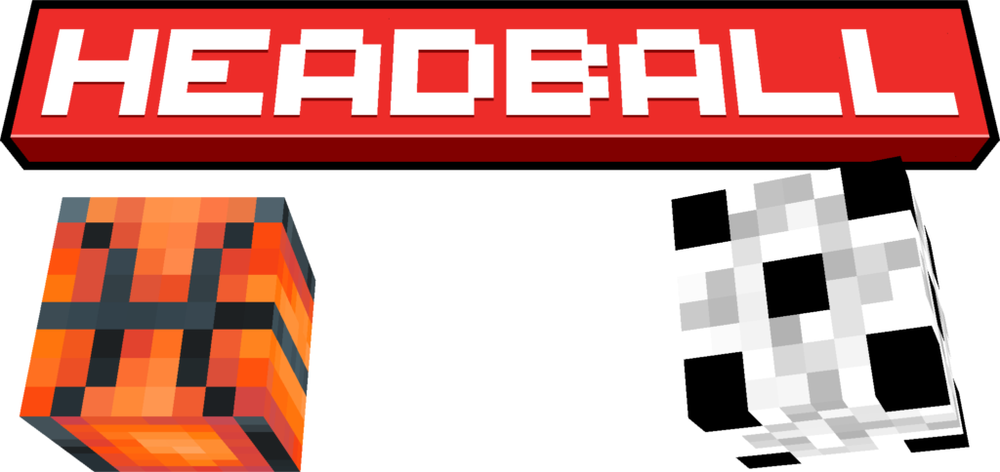

<p align="center">
  
</p>

<h1 align="center">HeadBall</h1>

<p align="center">
  <em>A plugin that adds game balls to Minecraft.</em>
</p>

---


## What the plugin does

The plugin adds game balls that players can interact with:

- `Right-click` on the ball to kick it.
- `Sprint + Right-click` to kick the ball harder.
- `Shift + Right-click` to pick up the ball.
- `Right-click while holding a ball` to throw / place it.

---

## Requirements

- Paper 1.20.1
- Java 17

---

## Features

- Football and volleyball with custom physics: gravity, bouncing, friction, and water behavior.
- Kick the ball with right-click.
- Power kick: football while sprinting, volleyball while jumping.
- Pick up a ball with `Shift + Right-click`.
- Drop the football at your feet (`Right-click` while holding it).
- Throw the volleyball (`Right-click` while holding it); throwing while jumping is stronger.
- Ball skins are defined as a list of Base64 textures; a random one is selected on spawn.
- Craft balls in a crafting table.
- Global ball limit and per-player limit; both can be disabled.
- Balls persist across server restarts.
- English and Russian localization; English is the default.

---

## Operator Commands

| Command                              | Permission        | Description                                                            |
|--------------------------------------|-------------------|------------------------------------------------------------------------|
| `/headball`                          | `headball.use`    | Show help                                                              |
| `/headball spawn <ball\|volleyball>` | `headball.use`    | Spawn a football or volleyball                                         |
| `/headball remove`                   | `headball.remove` | Remove all balls                                                       |
| `/headball remove all`               | `headball.remove` | Remove all balls and clean up leftover plugin entities in all worlds   |
| `/headball reload`                   | `headball.reload` | Reload the config and recipes                                          |

---

## Configuration

File: `plugins/HeadBall/config.yml`

```yaml
# Plugin language: en (English) or ru (Russian).
# Language files are stored in plugins/HeadBall/lang/.
language: en

# Global ball limit across all worlds.
max-balls: 50
# Maximum number of balls per player.
max-balls-per-player: 2
# Enable or disable the global ball limit.
world-limit-enabled: true
# Enable or disable the per-player ball limit.
player-limit-enabled: true

crafting:
  # Enable or disable ball crafting.
  enabled: true

ball:
  # List of Base64 skull textures. A random texture is selected for each new ball.
  texture:
    - "<base64-texture>"
  # Ball model scale.
  scale: 1.1
  # Vertical offset of the ball model.
  y-offset: 0.25
  # Tilt of the ball model.
  pitch: 0.0
  # Kick strength for a normal kick.
  kick-speed: 0.6
  # Kick strength while sprinting.
  kick-speed-sprint: 1.2
  # Vertical lift for a normal kick.
  kick-lift: 0.25
  # Vertical lift while sprinting.
  kick-lift-sprint: 0.40

volleyball:
  # List of Base64 skull textures. A random texture is selected for each new ball.
  texture:
    - "<base64-texture>"
  # Ball model scale.
  scale: 1.1
  # Vertical offset of the ball model.
  y-offset: 0.25
  # Tilt of the ball model.
  pitch: 0.0
  # Kick strength for a normal kick.
  kick-speed: 0.8
  # Kick strength while jumping.
  kick-speed-jump: 1.2
  # Vertical lift for a normal kick.
  kick-lift: 0.25
  # Vertical lift while jumping.
  kick-lift-jump: 0.40
  # Maximum downward speed while falling.
  fall-speed: 0.3
  # Throw strength for a normal throw.
  throw-speed: 0.8
  # Throw strength while jumping.
  throw-speed-jump: 1.2
  # Vertical lift for a normal throw.
  throw-lift: 0.25
  # Vertical lift while jumping.
  throw-lift-jump: 0.40
```

---

## Localization

English is enabled by default. To switch to Russian, set `language: ru` and run `/headball reload`.

Messages are stored in:

- `plugins/HeadBall/lang/en.yml`
- `plugins/HeadBall/lang/ru.yml`

---

## Crafting

Crafting can be completely disabled with `crafting.enabled: false`.

### Football

|                  |                 |                  |
|------------------|-----------------|------------------|
| Black Dye        | White Dye       | Black Dye        |
| White Wool       | White Wool      | White Wool       |
| Black Dye        | White Dye       | Black Dye        |

### Volleyball

|                  |                     |                  |
|------------------|---------------------|------------------|
| Black Dye        | Orange Dye          | Black Dye        |
| String           | Wool (any)          | String           |
| Black Dye        | Orange Dye          | Black Dye        |

> Custom recipes may not appear in the recipe book, but crafting in a crafting table works with the layout above.
